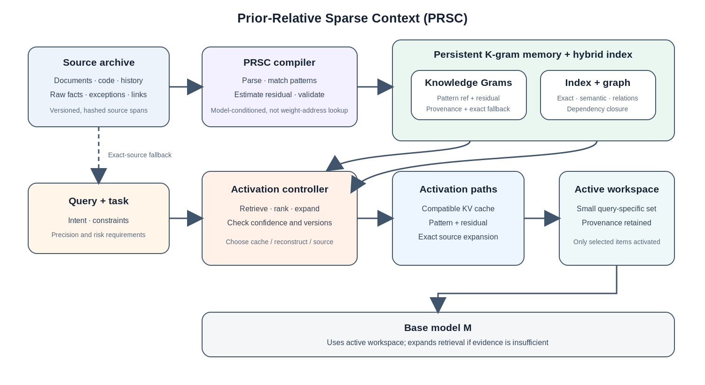

% Prior-Relative Sparse Context: Knowledge Grams for Selective Activation of Model-Relative Memory
% [Author name(s) and affiliation(s) to be completed]
% Version 0.1 — 15 November 2026

# Abstract

Large language models (LLMs) repeatedly process long contexts that contain a mixture of familiar structure, corpus-specific facts, exceptions, and relationships. Existing approaches reduce this cost through prompt compression, learned latent context, corpus-specific memory, retrieval, or reuse and transport of key-value (KV) caches. We propose **Prior-Relative Sparse Context (PRSC)**, an architecture that represents an external knowledge archive relative to a fixed base model. PRSC compiles source material into addressable **Knowledge Grams (K-grams)**: typed records that reference reusable patterns, encode instance-specific residuals, preserve provenance and relationships, and optionally point to compatible precomputed neural representations. At query time, a retrieval-and-activation controller selects a small, task-relevant working set, expands dependencies as needed, and loads compatible cached representations or reconstructs them from a canonical pattern plus residual. The archive remains external; only the active working set enters model computation.

The central hypothesis is not that arbitrary context can be losslessly reduced to logarithmic size. Rather, for workloads with repeated structure and localized queries, PRSC may make lookup sublinear in archive size and active context proportional to the information actually needed, while preserving task quality. We formalize this objective, describe a compilation and inference pipeline, specify compatibility and correctness constraints for KV activation, and propose an evaluation against full-context, retrieval, compression, and precomputed-cache baselines. No empirical results are claimed. The contribution is an architecture and research agenda for testing whether model-relative residuals can complement existing context-memory systems.

**Keywords:** long-context inference, context compression, external memory, key-value cache, retrieval-augmented generation, model-relative encoding, sparse activation, knowledge representation

# 1. Introduction

An LLM's context is often treated as a linear sequence that must be prefetched into the model before generation. This is a useful interface, but it is not necessarily the right storage abstraction for a large, persistent knowledge base. A code repository, a technical manual, or a long-running project history contains repeated conventions and structures alongside the few facts that are specific to that corpus. A model may already possess useful general competence about the conventions, but still needs access to exact names, values, exceptions, dependencies, and provenance.

This motivates a question: **can a context archive be represented primarily by references to structures that a model can already interpret, plus the residual information that distinguishes each instance?** If so, a query might activate only a small subset of the archive rather than repeatedly encoding the entire archive.

We call this architecture **Prior-Relative Sparse Context (PRSC)**. Its atomic representation is a **Knowledge Gram (K-gram)**: a versioned, addressable unit that contains (i) a reference to a reusable pattern or semantic structure, (ii) the residual payload required to identify the particular instance, (iii) typed relationships to other grams, (iv) provenance and exact-source fallback, and (v) optional references to precomputed model-specific representations such as KV-cache segments.

PRSC is deliberately a hybrid design. A pattern reference is not assumed to be a magical pointer into an LLM's distributed weights. Neural parameters generally do not expose a stable, explicit address for a concept or template. PRSC therefore introduces a typed pattern catalogue and a model-conditioned encoder/decoder that learns to map incoming material to that catalogue. For patterns that are not safely represented by the base model, the system stores a larger residual or the original source. When a query requires exact detail, the system can expand a gram or retrieve the canonical source instead of trusting an aggressively compressed representation.

The proposal combines and extends several established lines of work. Gisting compresses prompts into reusable learned activations [1]. Memorizing Transformers retrieve prior internal representations through approximate nearest-neighbor memory [2]. Cartridges learn corpus-specific KV representations offline and reuse them at inference time [3]. Latent Context Language Models (LCLMs) compress long inputs into latent sequences and support adaptive expansion of relevant segments [4]. TurboRAG precomputes chunk-level KV caches and composes them for retrieval [5], while CacheGen compresses and streams KV caches [6]. These results establish important building blocks; they do not, by themselves, establish the PRSC hypothesis that residuals relative to a model-specific pattern catalogue are a useful general-purpose representation.

## 1.1 Contributions

This paper makes five proposal-level contributions:

1. **A model-relative memory abstraction.** We define a K-gram as a structured reference-plus-residual record, with explicit provenance, uncertainty, compatibility, and source fallback.
2. **A compilation and activation architecture.** We describe how a frozen base model, a trainable encoder, a pattern catalogue, a graph index, and a cache manager can cooperate without modifying the base model's weights for every new archive.
3. **A task-preserving objective.** We formulate compression in terms of preserving query-conditioned task behavior rather than reconstructing every source token by default.
4. **A qualified complexity target.** We separate archive lookup, active-set size, prefill, and generation costs, and explain why logarithmic total context cost is not generally achievable.
5. **A falsifiable evaluation plan.** We specify baselines, ablations, benchmarks, metrics, and failure tests. We do not claim a working implementation or measured performance.

## 1.2 Scope and terminology

PRSC concerns external, persistent context for a fixed or explicitly versioned base model. It does not claim to shrink the model's parameter count, make model knowledge perfectly addressable, or eliminate the need to store unpredictable new facts. “Prior-relative” means that the encoder is conditioned on a particular model and its known capabilities; it does not mean that the model's weights are an exact symbolic dictionary. “Sparse context” means that only a query-specific subset is activated into the model's working memory. We write “K-gram” as shorthand for “Knowledge Gram”; it is not the conventional NLP term *k-gram*, which denotes a contiguous sequence of k tokens or symbols. “Logarithmic” refers only to a possible index-lookup target under stated data-structure assumptions, not to a universal bound on storage, reasoning, or attention computation.

# 2. Background and Related Work

## 2.1 Prompt compression and learned latent context

LLMLingua uses a coarse-to-fine strategy to remove less useful prompt tokens while attempting to preserve task-relevant information [7]. Gisting trains a model to compress prompts into a smaller set of reusable activation-bearing gist tokens [1]. Both illustrate that a long textual representation can sometimes be replaced by a smaller model-consumable representation. However, prompt compression alone does not necessarily create a persistent, addressable archive with explicit residual fields, typed dependencies, source provenance, and independent activation of subparts.

LCLMs revisit encoder-decoder context compression at scale and report models trained at 1:4, 1:8, and 1:16 compression ratios. Their agent design can skim compressed context and adaptively expand relevant segments [4]. This is close to PRSC's coarse-to-fine activation path. PRSC differs in making the representation a versioned collection of individually addressable semantic records, with references to a shared pattern catalogue and optional precomputed cache entries.

Cartridges provide an especially close precedent. They are smaller corpus-specific KV representations trained offline through synthetic conversations and context distillation; the reported results include substantial memory and throughput improvements and inference-time composition [3]. PRSC does not claim that corpus-specific KV memory is new. Its question is whether an explicit model-relative residual layer can improve composability, update granularity, provenance, and selectivity beyond a corpus-level distilled representation.

## 2.2 External memory and test-time learning

Memorizing Transformers add approximate nearest-neighbor memory over internal key-value representations and show that a model can use information introduced at inference time, including newly defined functions and theorems [2]. Titans introduce a learned long-term neural memory that complements attention's shorter-term context [8]. These approaches reinforce the idea that the active context window need not be the only place where useful information lives. PRSC instead emphasizes externally addressable, inspectable, versioned records and residual encoding against a model-conditioned pattern catalogue.

## 2.3 KV-cache reuse, composition, and streaming

TurboRAG precomputes chunk-level KV caches and stitches retrieved chunks using independent-attention and reordered-RoPE techniques [5]. CacheGen encodes KV caches into compact bitstreams and streams them according to network conditions [6]. SCBench evaluates the KV-cache lifecycle, including generation, compression, retrieval, and loading [9]. A 2026 preprint studies editable and composable KV-cache notes [10]. These works make on-demand activation technically plausible, but cache reuse has strict compatibility constraints: model weights, tokenizer, positional scheme, attention implementation, layer layout, quantization, and the conditioning context can all matter. PRSC treats cache compatibility as an explicit validation gate, not as an assumption.

## 2.4 Positioning

| Line of work | What it establishes | PRSC's proposed addition |
|---|---|---|
| Prompt compression (e.g., LLMLingua) | Remove or rewrite prompt content | Persistent, typed records with source fallback and relationships |
| Gist/latent context | Encode context into shorter learned representations | Fine-grained references and residual payloads relative to a model-specific catalogue |
| Cartridges | Reusable corpus-specific KV memory | Decomposed, independently addressable knowledge units and explicit residuals |
| External neural memory | Retrieve information from persistent memory | Human-inspectable provenance, versioning, and exact-source recovery |
| Precomputed KV retrieval/streaming | Reuse or transport neural cache states | A controller that chooses among cache loading, regeneration, and source expansion |

This is a positioning against selected relevant work, not an exhaustive novelty or priority survey. The proposed combination may overlap with concurrent or unreviewed work not covered here.

# 3. Problem Formulation

Let:

- \(M\) be a frozen base model with a specified model and tokenizer revision;
- \(X\) be an external archive, such as a repository or document collection;
- \(Q\) be a query or task sampled from workload distribution \(\mathcal{D}_Q\);
- \(Y\) be the desired task output;
- \(Z=E_\phi(X;M)\) be the PRSC representation produced by encoder \(E_\phi\);
- \(A(Z,Q;M)\) be the query-conditioned active representation produced by an activation controller.

A conventional full-context system computes an output using the entire or a large portion of \(X\). PRSC instead seeks to produce a compact persistent representation \(Z\) and activate only \(Z_Q=A(Z,Q;M)\).

The target is task preservation:

\[
\min_{E_\phi,A} \; \mathbb{E}_{Q\sim\mathcal{D}_Q}
\left[\mathcal{L}_{task}\left(P_M(\cdot\mid X,Q),P_M(\cdot\mid Z_Q,Q)\right)\right]
+ \lambda_s S(Z) + \lambda_a C(A(Z,Q;M)).
\]

Here \(S(Z)\) measures persistent storage and \(C\) measures query-time activation cost. The loss may be task-specific: exact symbol resolution, answer correctness, code-test pass rate, or divergence between the full-context and compressed-context output distributions. The weights \(\lambda_s\) and \(\lambda_a\) express storage and latency trade-offs.

A complementary distillation-style constraint is:

\[
D\left(P_M(Y\mid X,Q),P_M(Y\mid Z_Q,Q)\right)\leq\epsilon,
\]

where \(D\) measures a task-appropriate discrepancy. This is a design objective, not a guarantee that a learned encoder can satisfy it for arbitrary corpora and queries.

## 3.1 Why model-relative residuals may help

If a base model already represents a reusable structure well, encoding every instance as raw text can duplicate information. PRSC attempts to factor an instance into a catalogue reference and an instance-specific residual:

\[
X_i \rightsquigarrow (p_i, r_i, e_i),
\]

where \(p_i\) is a pattern reference, \(r_i\) is residual information, and \(e_i\) contains links and evidence. This is a conceptual factorization, not literal subtraction in weight space. The catalogue may contain symbolic templates, learned latent prototypes, canonical prompt fragments, or model-specific activation recipes.

The central uncertainty is whether the pattern reference can be made compact and reusable without hiding important information in opaque latent state. PRSC therefore keeps source spans and confidence values, and should escalate to a larger residual or original-source retrieval whenever confidence is low or exactness is required.

## 3.2 Lower bounds and non-goals

If an archive contains \(B\) independent, unpredictable bits that are not represented in \(M\), a system cannot losslessly encode all of them in substantially fewer than \(B\) bits without additional assumptions. Model-relative compression is useful only to the extent that the archive contains redundancy, predictable structure, or information irrelevant to the workload.

PRSC does not promise:

- lossless reconstruction of every source token from a tiny residual;
- logarithmic storage in total archive size;
- constant-size active context for tasks requiring broad global comparison;
- universal KV-cache portability across models or positions;
- safe compression based only on language-model surprisal or semantic similarity.

# 4. Architecture

Figure 1 shows the proposed pipeline. The persistent archive is external to the base model. The compiler produces K-grams and a graph/index. A query-time controller retrieves a candidate set, expands required dependencies, validates cache compatibility, and constructs an active working set. It may load precomputed KV data, reconstruct a representation from a canonical pattern and residual, or fall back to exact source text.

{ width=95% }

## 4.1 Components

**Base model \(M\).** A pretrained model with fixed, recorded weights and tokenizer revision. PRSC does not assume that concepts have direct addresses in its weights.

**Pattern catalogue \(P_M\).** A versioned collection of typed reusable structures. Entries may be symbolic patterns (AST templates, API schemas, semantic frames), trained latent prototypes, or canonical conditioning snippets. Each entry declares the tasks and modalities for which it is valid, and the model revisions for which its activations were tested.

**Knowledge encoder \(E_\phi\).** Parses source material, identifies candidate structures, estimates novelty and task-criticality, aligns segments to catalogue entries, and emits residual payloads. It should preserve exact identifiers, numbers, negations, exceptions, temporal facts, and low-confidence spans rather than compress them away.

**K-gram store.** Stores records and payloads in a durable external archive. It supports independent updates and retains provenance, source hashes, timestamps, access labels, and exact-source fallback.

**Hierarchical index.** Combines exact-key and symbol indexes, lexical or dense retrieval, and a relationship graph. Exact indexes serve identifiers and known entities; semantic retrieval identifies candidate concepts; graph traversal follows dependencies and references.

**Activation controller.** Ranks candidate grams by expected task utility per unit cost, computes a dependency closure where necessary, checks uncertainty and compatibility, and decides whether to load a cache, reconstruct a representation, or expand original source.

**Cache manager.** Stores optional model-specific KV segments or other neural representations. Cache manifests contain a model fingerprint, tokenizer fingerprint, cache format, positional metadata, layer layout, quantization configuration, and provenance. A mismatch must invalidate reuse or trigger explicit adaptation/recomputation.

**Active workspace.** The currently materialized K-grams, source expansions, and compatible KV entries. It is the only part of the archive intended to occupy the model's active context or device memory for the current query.

## 4.2 Knowledge Gram data model

A K-gram is an addressable record, not necessarily a single token sequence. A minimal record has:

| Field | Purpose |
|---|---|
| `gram_id` | Stable identifier within an archive namespace |
| `model_compatibility` | Base-model, tokenizer, adapter, and encoder fingerprints |
| `pattern_ref` | Typed reference to a catalogue structure |
| `residual` | Symbolic, textual, latent, or patch-like instance-specific payload |
| `relations` | Typed links to other K-grams, including required dependencies |
| `provenance` | Source URI, span, content hash, and update metadata |
| `activation` | Preferred activation path and optional cache manifest |
| `confidence` | Calibrated estimate of safe reuse for declared tasks |
| `exact_fallback` | Pointer to the original source or an independently verifiable payload |

The example in `examples/knowledge-gram.example.json` and schema in `schemas/knowledge-gram.schema.json` define a candidate serialization. The schema is illustrative and can evolve before implementation.

## 4.3 Compile-time workflow

1. **Ingest and fingerprint.** Split the archive into source-addressable units; preserve stable IDs and cryptographic hashes.
2. **Parse and annotate.** Use modality-specific parsers where possible (e.g., ASTs and symbol tables for code; entities, relations, and document structure for prose).
3. **Match patterns.** Retrieve candidate catalogue entries using exact structural matching and model-conditioned semantic matching.
4. **Estimate residuals.** Encode the parts not safely covered by the candidate pattern. Preserve task-critical details, exceptions, and provenance.
5. **Build relations.** Add explicit dependency, reference, containment, temporal, and contradiction edges.
6. **Validate.** Reconstruct sampled source units, test behavioral invariants, and reject unsafe compression. Keep exact-source fallback.
7. **Optionally precompute activations.** Generate KV representations only for reusable units with a well-defined canonical conditioning context and supported cache semantics.
8. **Index and publish.** Store the K-grams, indexes, cache manifests, and archive version atomically.

## 4.4 Query-time activation

For a query \(Q\), the controller:

1. classifies the task and extracts exact identifiers, constraints, and requested precision;
2. retrieves candidate grams using exact, lexical, semantic, and graph indexes;
3. estimates the utility and confidence of each candidate;
4. expands required dependencies and checks for contradictions or stale versions;
5. selects a representation path for each gram: cached KV, reconstructed latent/symbolic representation, or exact-source expansion;
6. validates model/cache compatibility before loading neural states;
7. assembles a small active workspace and exposes provenance to the answer generator;
8. monitors for uncertainty or evidence of a missing dependency, then retrieves more context if needed.

This makes activation adaptive rather than fixed top-k retrieval. A query about one function may activate only a few grams; a query about a global architectural property may require a much larger dependency closure or even the whole archive.

# 5. Algorithms and Training Objectives

## 5.1 Compilation algorithm

```text
COMPILE(archive X, base model M, pattern catalogue P_M):
    units <- source_aware_partition_and_parse(X)
    grams <- []
    for unit in units:
        candidates <- MATCH_PATTERNS(unit, P_M)
        pattern <- select candidate using structural fit and calibrated confidence
        if pattern is absent or confidence is insufficient:
            residual <- preserve unit at a conservative fidelity level
            pattern_ref <- null
        else:
            residual <- ENCODE_RESIDUAL(unit, pattern)
            pattern_ref <- pattern.id
        relations <- EXTRACT_RELATIONS(unit, units)
        evidence <- RECORD_PROVENANCE(unit, X)
        if not VALIDATE_RECONSTRUCTION(unit, pattern_ref, residual):
            residual <- exact_or_high_fidelity_payload(unit)
        grams.append(K_GRAM(pattern_ref, residual, relations, evidence))
    index <- BUILD_HYBRID_INDEX(grams)
    caches <- OPTIONAL_PRECOMPUTE_COMPATIBLE_ACTIVATIONS(grams, M)
    return COMMIT_VERSIONED_ARCHIVE(grams, index, caches)
```

The routine is deliberately conservative: a pattern match is not enough to discard the source. The encoder must demonstrate reconstruction or task preservation on the relevant validation cases.

## 5.2 Activation algorithm

```text
ACTIVATE(query Q, archive Z, base model M, budget B):
    intent <- ANALYZE_QUERY(Q)
    candidates <- HYBRID_RETRIEVE(Z.index, intent)
    candidates <- ADD_REQUIRED_DEPENDENCIES(candidates, Z.graph)
    ranked <- RANK_BY_EXPECTED_UTILITY_PER_COST(candidates, intent)
    active <- []
    for gram in ranked:
        if budget_exceeded(active, gram, B):
            break
        if cache_manifest_compatible(gram, M):
            item <- LOAD_PRECOMPUTED_ACTIVATION(gram)
        elif reconstruction_is_confident(gram, intent):
            item <- RESOLVE_PATTERN_AND_RESIDUAL(gram)
        else:
            item <- EXPAND_EXACT_SOURCE(gram)
        active.append(VERIFY_AND_ATTACH_PROVENANCE(item, gram))
    if insufficient_evidence(active, intent):
        active <- EXPAND_RETRIEVAL_OR_SOURCE(active, intent)
    return BUILD_ACTIVE_WORKSPACE(active)
```

The activation budget is a soft constraint. If the controller cannot answer reliably under the budget, it should expand the working set or report that the evidence is insufficient rather than silently omit necessary information.

## 5.3 Training objective

A practical encoder and pattern catalogue could be trained with a multi-objective loss:

\[
\mathcal{L} = \mathcal{L}_{task}
+ \lambda_r \mathcal{L}_{rate}
+ \lambda_x \mathcal{L}_{reconstruct}
+ \lambda_p \mathcal{L}_{provenance}
+ \lambda_c \mathcal{L}_{calibration}
+ \lambda_a \mathcal{L}_{activation}.
\]

- \(\mathcal{L}_{task}\): preserve task outputs or behavior under a workload distribution.
- \(\mathcal{L}_{rate}\): penalize archive size and active-set cost.
- \(\mathcal{L}_{reconstruct}\): preserve exact or behaviorally important details where required.
- \(\mathcal{L}_{provenance}\): ensure each claim or residual can be traced to source evidence.
- \(\mathcal{L}_{calibration}\): align confidence with empirical failure probability.
- \(\mathcal{L}_{activation}\): optimize retrieval and expansion decisions under realistic latency and bandwidth budgets.

The training data must include adversarially similar examples, rare identifiers, negative conditions, version changes, and exceptions. Optimizing token-level surprisal alone is inadequate because a low-surprisal token can be essential (for example, a negation, a version number, or a single changed argument name).

# 6. Complexity Analysis and the Logarithmic Hypothesis

Let \(N\) be the number of indexed grams, \(S\) the total bytes in the persistent archive, and \(k\) the number of grams activated for a query. A useful query cost decomposition is:

\[
T_{query} = T_{lookup}(N) + T_{expand}(k) + T_{load}(k) + T_{prefill}(k) + T_{decode}(Q,Y).
\]

Under a balanced B-tree or similar exact index, a lookup can require \(O(\log N)\) index steps. Graph expansion is output-sensitive and may be closer to \(O(k + e_k)\), where \(e_k\) is the number of traversed relations. Approximate nearest-neighbor indexes can be sublinear in practice, but their guarantees depend on the index, data distribution, and recall target; PRSC does not assume a universal logarithmic bound for dense retrieval.

The desired regime is therefore:

- **Persistent storage:** proportional to the information that must actually be retained; not generally logarithmic in archive size.
- **Index lookup:** logarithmic for suitable exact indexes, or empirical sublinear behavior for approximate retrieval.
- **Active memory:** proportional to the query-specific working set \(k\), not the full archive \(N\).
- **Prefill and decode:** depend on the activated representations and model architecture; exact attention and broad global tasks can still be expensive.

A small \(k\) is possible when queries are local and the archive has reusable structure. It is not possible to promise small \(k\) for tasks that genuinely require inspecting many independent records. The proper claim is **sparse activation with potentially logarithmic archive lookup**, not logarithmic total context computation.

# 7. Correctness, Cache Compatibility, and Safety

## 7.1 Cache compatibility is a hard constraint

A precomputed KV object must be treated as model-specific executable state. At minimum, the manifest should bind it to:

- exact model weights and revision;
- tokenizer and vocabulary revision;
- adapter/LoRA stack and relevant routing configuration;
- positional encoding and RoPE parameters;
- attention implementation and layer/head layout;
- cache dtype, quantization, page/block format, and serialization version;
- canonical conditioning context and position semantics.

Even when tensor shapes match, the cache may be semantically incompatible. Independently encoded chunks cannot simply be concatenated unless the attention mask, position mapping, and inter-chunk dependencies make that operation valid. Methods such as independent attention, RoPE repositioning, or boundary recomputation are model- and method-specific techniques, not universally safe transformations [5, 10].

PRSC should initially use the conservative path: cache only independently validated units, store a manifest, reject mismatches, and fall back to text or latent recomputation. Cache composition can be introduced incrementally with equivalence tests against full prefill.

## 7.2 Exactness tiers

We propose three activation tiers:

- **Tier 0 — exact source:** retrieve original bytes/tokens or a lossless symbolic representation; use for code execution, legal clauses, numeric facts, and audit-sensitive claims.
- **Tier 1 — validated structured reconstruction:** resolve a known pattern plus residual and validate the relevant fields or behavior.
- **Tier 2 — approximate latent activation:** use compressed activations when the task tolerates approximation and confidence is calibrated.

A controller must choose a tier based on task risk and requested precision, not solely on a compression budget.

## 7.3 Provenance and trust boundaries

K-grams are data, not instructions. Retrieved source text may contain prompt injection or malicious instructions. The generator must preserve a strict separation between system instructions and untrusted archive content. Provenance, content hashes, access controls, and version histories are required to detect tampering and stale data. A gram with a missing source, invalid hash, ambiguous ownership, or conflicting versions should not be silently promoted to trusted memory.

## 7.4 Privacy and deletion

The archive may contain sensitive material. It should support per-source deletion, cryptographic erasure where appropriate, access-control labels, retention policies, and cache invalidation. Deleting a source requires deleting or rebuilding all derived grams, indexes, and KV objects that depend on it; otherwise derived memory may preserve the supposedly deleted information.

# 8. Evaluation Plan

The first prototype should target software repositories, where structures are explicit and correctness can be tested. A second phase should test natural-language corpora and project histories.

## 8.1 Research questions and hypotheses

- **RQ1 — Compression:** Does model-relative pattern-plus-residual encoding reduce persistent and active memory at matched task quality compared with generic prompt compression and retrieval?
- **RQ2 — Reuse:** Does a shared pattern catalogue improve compression across multiple repositories or documents compared with independently learned corpus memories?
- **RQ3 — Activation:** Does graph-aware, confidence-triggered activation outperform fixed top-k retrieval on dependency-heavy questions?
- **RQ4 — KV reuse:** When does precomputed activation reduce time-to-first-token after accounting for cache storage, network transfer, and compatibility checks?
- **RQ5 — Robustness:** Which categories of facts, exceptions, edits, or adversarial examples are lost by compression, and can exact-source fallback recover them?

Pre-registered hypotheses:

- **H1:** At matched task quality, PRSC reduces active context or KV bytes for workloads with repeated patterns and local queries.
- **H2:** A shared pattern catalogue improves storage amortization when the same structures recur across archives.
- **H3:** Dependency-aware activation improves answer accuracy on cross-file and cross-document tasks relative to flat top-k retrieval at the same budget.
- **H4:** Precomputed KV activation reduces TTFT only when reuse frequency and cache-transfer conditions amortize cache generation and storage costs.

These are hypotheses, not reported findings.

## 8.2 Baselines

1. **Full context:** all relevant source material provided to the base model, with the strongest feasible context window.
2. **Text RAG:** chunked retrieval followed by ordinary text prefill.
3. **Prompt compression:** LLMLingua or a comparable compressor [7].
4. **Gist/latent context:** Gist Tokens or LCLM-style compression where available [1, 4].
5. **Corpus-specific memory:** Cartridges-style corpus memory [3].
6. **Precomputed KV retrieval:** TurboRAG-style cache retrieval [5], with CacheGen-style transfer compression when applicable [6].
7. **PRSC ablations:** remove the pattern catalogue, residual coding, graph edges, confidence gating, exact-source fallback, or KV activation one at a time.

All baselines should use the same base model where feasible. If a baseline requires a different model or retraining recipe, disclose that mismatch and report both quality and systems costs.

## 8.3 Workloads and datasets

Use a mix of controlled and realistic tasks:

- repository-level symbol and dependency questions;
- exact retrieval of rare identifiers, constants, and version-specific behavior;
- cross-file debugging and code change impact analysis;
- repository question answering and patch generation with tests;
- long-document fact retrieval, multi-document synthesis, and temporal contradiction resolution;
- shared-context and KV-lifecycle evaluations such as SCBench [9];
- long-context stress tests such as RULER or LongBench, with the exact model and configuration documented.

Repository corpora should include both repeated patterns and unique facts. Synthetic cases should explicitly test negation, one-token changes, stale versions, ambiguous references, and facts that are statistically unsurprising but task-critical.

## 8.4 Metrics

| Category | Metric |
|---|---|
| Task quality | Exact match, answer F1, code test pass rate, patch acceptance, human preference |
| Compression | Source-to-archive bytes, gram payload bytes, active tokens, active KV bytes |
| Retrieval | Recall@k, dependency recall, provenance coverage, stale-reference rate |
| Systems | Index latency, compile cost, TTFT, decode throughput, end-to-end latency, GPU/CPU memory, network bytes |
| Amortization | Queries-to-break-even, total cost over realistic query-frequency distributions |
| Reliability | Calibration error, fallback frequency, false-compression rate, silent omission rate |

Report quality-versus-cost Pareto curves, not a single compression ratio. Include the cost of compilation, cache storage, cache transfer, graph maintenance, and fallback. A system that uses less active context but requires expensive preprocessing may only win for repeatedly queried archives.

## 8.5 Essential ablations and failure tests

- Disable model-relative pattern references and retain residuals only.
- Replace model-relative patterns with generic symbolic templates.
- Remove relation edges and compare dependency recall.
- Remove exact-source fallback and measure silent failure.
- Vary the base model revision and verify invalidation behavior.
- Test code with near-identical implementations that differ in one semantically critical token.
- Test changing facts, source deletions, and conflicting versions.
- Measure retrieval as archive size grows while holding query-local working-set size roughly fixed.
- Compare cache reuse against recomputation under different network bandwidths and cache hit rates.

# 9. Limitations and Open Problems

**Addressability of pretrained knowledge.** The model's internal knowledge is distributed. A catalogue and encoder must learn a stable interface to that knowledge; it cannot be assumed to exist natively.

**Domain and model dependence.** A pattern that is useful for one model, tokenizer, or domain may not transfer. The pattern catalogue and cached activations require versioning and regression tests.

**Residual estimation is difficult.** The difference between “already known” and “new” is query-dependent. A model can appear familiar with a concept while lacking the exact detail needed for a particular answer.

**Global tasks expand the working set.** Summaries, audits, comparisons, and anomaly detection may require broad traversal. The architecture reduces unnecessary work; it does not remove necessary work.

**Cache composition is nontrivial.** KV states encode contextual dependencies. A reusable cache must be independently meaningful or transformed under a validated attention and positional scheme.

**Compilation can be expensive.** The benefit depends on archive reuse frequency. A one-off query may be cheaper with ordinary text RAG.

**Evaluation is workload-sensitive.** Compression quality measured on one query distribution may fail on another. A credible system must disclose its supported tasks, test distribution shifts, and preserve source fallback.

# 10. Roadmap

A staged research programme minimizes premature engineering:

1. **Symbolic K-gram prototype:** parse code into functions, classes, symbols, and dependencies; use explicit templates plus structured residuals; retrieve exact source for generation.
2. **Model-relative encoder:** train an encoder to choose catalogue patterns and residual representations using task-preservation and exact-detail losses.
3. **Confidence-aware activation:** implement hybrid retrieval, dependency closure, confidence thresholds, and source fallback.
4. **Latent and KV activation:** add precomputed representations only after the symbolic system has passed correctness tests; validate against fresh prefill for every cache path.
5. **Cross-archive reuse:** measure whether common patterns amortize across multiple repositories or domains.
6. **Open evaluation:** publish configs, model fingerprints, corpus hashes where licensing allows, failure cases, and full cost accounting.

# 11. Conclusion

PRSC proposes treating an LLM's external context as a persistent, model-relative memory archive rather than a sequence that must always be re-read. Knowledge Grams encode reusable pattern references, instance-specific residuals, relationships, provenance, and optional precomputed neural representations. A query-time controller activates a small working set and expands to exact source when the task or confidence requires it.

The proposal is intentionally more conservative than a claim of “logarithmic context.” Index lookup may be logarithmic under suitable data structures, but total storage remains tied to the information that must be retained, and broad tasks may require broad activation. The key empirical question is whether a model-conditioned catalogue can reliably separate reusable prior structure from the residual facts that distinguish a particular archive. Existing work on Cartridges, latent context, gist tokens, external memory, precomputed KV caches, and cache streaming makes the components plausible. Whether their integration yields a distinct and useful trade-off remains to be demonstrated.

# References

[1] Jesse Mu, Xiang Lisa Li, and Noah Goodman. “Learning to Compress Prompts with Gist Tokens.” *Advances in Neural Information Processing Systems 36*, 2023. https://arxiv.org/abs/2304.08467. DOI: 10.52202/075280-0848.

[2] Yuhuai Wu, Markus Rabe, DeLesley Hutchins, and Christian Szegedy. “Memorizing Transformers.” *International Conference on Learning Representations*, 2022. https://arxiv.org/abs/2203.08913.

[3] Sabri Eyuboglu, Ryan Ehrlich, Simran Arora, Neel Guha, Dylan Zinsley, Emily Liu, Atri Rudra, James Y. Zou, Azalia Mirhoseini, and Christopher Ré. “Cartridges: Lightweight and General-Purpose Long Context Representations via Self-Study.” *International Conference on Learning Representations*, 2026. https://proceedings.iclr.cc/paper_files/paper/2026/hash/4681359a7b1e94571598ad1adda35e6e-Abstract-Conference.html.

[4] Ang Li, Sean McLeish, Haozhe Chen, Nimit Kalra, Zaiqian Chen, Artem Gazizov, Venkata Anoop Suhas Kumar Morisetty, Bhavya Kailkhura, Harshitha Menon, Zhuang Liu, Brian R. Bartoldson, Tom Goldstein, Sanae Lotfi, Micah Goldblum, and Pavel Izmailov. “End-to-End Context Compression at Scale.” arXiv preprint arXiv:2606.09659, 2026. https://arxiv.org/abs/2606.09659.

[5] Songshuo Lu, Hua Wang, Yutian Rong, Zhi Chen, and Yaohua Tang. “TurboRAG: Accelerating Retrieval-Augmented Generation with Precomputed KV Caches for Chunked Text.” *Proceedings of EMNLP 2025*, pp. 6588–6601. https://aclanthology.org/2025.emnlp-main.334/. DOI: 10.18653/v1/2025.emnlp-main.334.

[6] Yuhan Liu, Hanchen Li, Yihua Cheng, Siddhant Ray, Yuyang Huang, Qizheng Zhang, Kuntai Du, Jiayi Yao, Shan Lu, Ganesh Ananthanarayanan, Michael Maire, Henry Hoffmann, Ari Holtzman, and Junchen Jiang. “CacheGen: KV Cache Compression and Streaming for Fast Large Language Model Serving.” *Proceedings of ACM SIGCOMM 2024*, pp. 38–56. https://doi.org/10.1145/3651890.3672274.

[7] Huiqiang Jiang, Qianhui Wu, Chin-Yew Lin, Yuqing Yang, and Lili Qiu. “LLMLingua: Compressing Prompts for Accelerated Inference of Large Language Models.” *Proceedings of EMNLP 2023*, pp. 13358–13376. https://aclanthology.org/2023.emnlp-main.825/. DOI: 10.18653/v1/2023.emnlp-main.825.

[8] Ali Behrouz, Peilin Zhong, and Vahab Mirrokni. “Titans: Learning to Memorize at Test Time.” *Advances in Neural Information Processing Systems 38*, 2025. https://proceedings.neurips.cc/paper_files/paper/2025/hash/a4ca07aa108036f80cbb5b82285fd4b1-Abstract-Conference.html. DOI: 10.52202/085713-3786.

[9] Yucheng Li, Huiqiang Jiang, Qianhui Wu, Xufang Luo, Surin Ahn, Chengruidong Zhang, Amir Abdi, Dongsheng Li, Jianfeng Gao, Yuqing Yang, and Lili Qiu. “SCBench: A KV Cache-Centric Analysis of Long-Context Methods.” *International Conference on Learning Representations*, 2025. https://proceedings.iclr.cc/paper_files/paper/2025/hash/a540b17fb2295c736d5afd6c507acf66-Abstract-Conference.html. arXiv:2412.10319.

[10] Bojie Li. “Models Take Notes at Prefill: KV Cache Can Be Editable and Composable.” arXiv:2606.17107, 2026. https://arxiv.org/abs/2606.17107. Preprint; not peer-reviewed as of this version.

# Publication Note

This document is a research proposal and architecture specification, not a report of completed experiments. Before public submission, replace the author placeholder, verify bibliographic details and current versions, review applicable licenses, and update the related-work search. Any implementation or empirical claims added later should be supported by reproducible artifacts and measurements.
